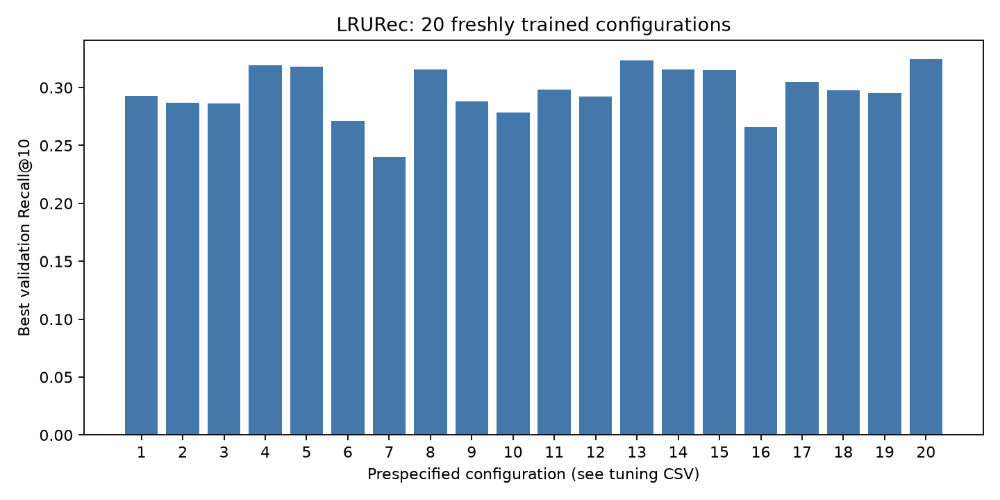
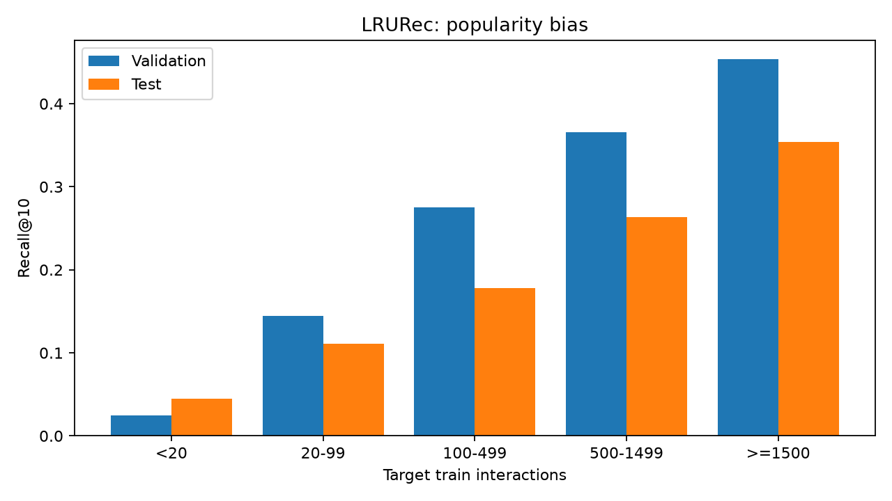

# LRURec（WSDM 2024 新算法）— 实现与结果

> **状态**：✅ 已完成（全新 20 组训练、验证集选参、最终评估、错误分析、推荐导出）。
> **最后更新**：2026-11-09
> **配套**：[README.md](README.md) · [DATA.md](DATA.md) · [TASKS.md](TASKS.md)
> **实验摘要**：[results/lrurec/](results/lrurec/README.md)；旧 10 组和中止任务均不计入本次 20 组。

## 0. 一句话状态

本项目三个算法中的第 ③ 个已完成。全量 test Recall@10＝**0.2272**，NDCG@10＝**0.1233**，在当前统一切分和评估协议下高于 Item-CF 与 LightFM。
与仓库记录的 LightFM 比较，full Recall@10 相对提升 **193.1%**，NDCG@10 相对提升 **209.8%**。提升同时包含模型结构、训练目标和超参的差异，不能全部归因于交互顺序。

**实验时间顺序**：此前的 10 组已计算过 test；用户要求将旧结果排除，完整重跑 20 组。本次每组从随机初始化开始，统一 GPU、相同训练预算；本次只在全部 20 组选参后评估一次 test。由于原 test 已查看，此处属于同一测试集上的重复实验，不应写成新的未见测试集验证。

## 1. 模块清单

| 模块/产物 | 路径 |
|---|---|
| 官方结构适配 | `src/adapters/lrurec_model.py` |
| 训练与统一适配器 | `src/adapters/lrurec.py` |
| 完整新 20 组运行器 | `src/adapters/lrurec_fresh20.py` |
| 4 项算法正确性测试 | `tests/test_lrurec.py` |
| 3 项新实验验收 | `tests/test_lrurec_fresh20.py` |
| 版本化指标、20 组记录、两张图 | [results/lrurec/](results/lrurec/README.md) |
| 本次完整本地产物 | `outputs/lrurec_fresh20_cuda_20261109/` |

## 2. 算法定义

输入是用户按时间排列的电影交互序列。电影编号先转换为 embedding，再通过 LRU block（线性循环单元、残差、LayerNorm、非线性前馈层）产生序列状态。核心递推为：

$$h_t=\Lambda h_{t-1}+\gamma\odot Bx_t,\qquad y_t=\operatorname{Re}(Ch_t)+x_t.$$

其中 $\Lambda$ 为复数对角参数，以半径和相位稳定初始化；并行前缀计算减少训练阶段逐时间步递推的依赖。最后一个有效状态 $z_u$ 与电影 embedding 打分，保留官方偏置：

$$s(u,i)=z_u^\top e_i+b_i.$$

训练使用有效位置的下一物品全量交叉熵、Adam 与梯度裁剪。只对非 padding 的训练位置投影到完整物品空间；推理只投影最后一个位置。输出与官方完整投影数学等价，已用测试校验。当前适配器按批重新编码历史，没有实现增量状态缓存的性能基准。

### 数据与评估边界

- 只读 `read_canon_table("ratings")`，不解析原始文件、不重新切分。按 `(uid, ts, iid)` 稳定排序。
- 模型电影编号为 `iid+1`，0 只作 padding；评分数值不参与训练。
- 训练窗口覆盖 train 中的每个相邻转换一次，窗口边界保留前一物品；首条无历史事件和 padding 不参与损失。
- val 和 test 均使用 train 历史作为推理输入；test 不追加 val，以统一现有三个模型的信息范围。这不同于官方常见的 test 输入 train+val 协议。
- 调参及 early stopping 只看 full val；本次 20 组结束后冻结配置。
- full / 101 候选使用同一分数矩阵，指标仅由 `src/evaluate.py` 计算。val 排除 train；test 排除 train∪val。
- 演示推荐额外排除 train∪val∪test，保证推荐用户尚未交互的电影。

## 3. 运行

### 环境与数据

已验证：Python **3.13.12**、PyTorch **2.7.1+cu128**、CUDA **12.8**、NVIDIA RTX 5060 Laptop GPU。精确依赖见 [requirements-lrurec-cuda.txt](requirements-lrurec-cuda.txt)。先按 README 准备 MovieLens-1M 并生成 canon。

```powershell
python -m venv .venv-lrurec-cuda
$py = '.\.venv-lrurec-cuda\Scripts\python.exe'
& $py -m pip install -r requirements-lrurec-cuda.txt
$env:PYTHONUTF8 = '1'
& $py -m src.build_canon --check
```

无 CUDA 的环境可以安装普通 `requirements.txt`，使用 `--device cpu --workers 1`；CPU 运行更慢，数值也可能因设备和依赖版本出现细微差异。CUDA 版安装方式可参考 [PyTorch 官方说明](https://pytorch.org/get-started/previous-versions/)。

### 一次完整新实验

```powershell
$run = 'outputs/lrurec_run20'
& $py -u -m src.adapters.lrurec_fresh20 --run-dir $run --workers 1 --device cuda --epochs 5 --patience 2
```

该命令自动完成：预定 20 组 → 每组重新初始化并训练 → 在 val 上选定配置 → 本次 test 一次 → 推荐导出 → 错误分析。目录必须是新的；已存在时会拒绝复用检查点，另开实验应换目录名。全新克隆无需先产生旧 10 组结果。

### 只验收、查看推荐或重建图表

```powershell
# 本机已有的这次实验目录：
$run = 'outputs/lrurec_fresh20_cuda_20261109'
& $py -m src.adapters.lrurec_fresh20 --run-dir $run --check
& $py -m src.adapters.lrurec_fresh20 --run-dir $run --top --uid 42
& $py -m src.adapters.lrurec_fresh20 --run-dir $run --analyze

# 算法测试 + 本次实验验收；自定义目录需设置这个环境变量
$env:LRUREC_FRESH20_DIR = $run
& $py -m unittest discover -s tests -p 'test_lrurec.py' -v
& $py -m unittest discover -s tests -p 'test_lrurec_fresh20.py' -v
```

`--check` 不重新训练或计算 test 指标；它核验 20 组记录与清单、无旧检查点复用、最佳配置选择、模型重载分数一致、推荐数量/唯一性/历史排除、分档汇总与总指标一致、数据指纹及可用的原实验保护哈希。GitHub 的 `results/lrurec/` 提供可浏览的摘要；完整模型、分数与推荐需在本地生成。

## 4. 结果

### 20 组调参及最终配置

20 套配置分别重新训练，统一最多 **5 epoch**、patience=2、batch=32、seed=42。最终选中第 **20** 组第 **5** 轮：hidden=64、layers=1、maxlen=50、dropout=0.1、learning_rate=0.001。选择规则为 val Recall@10 最大，平局比较 NDCG，再平局保留较早组号。

最佳 val Recall@10＝**0.324503**，NDCG@10＝**0.187003**。完整记录：[20 组 CSV](results/lrurec/lrurec_tuning_val.csv) · [最终参数](results/lrurec/lrurec_params.json)。



### test 主表与副表

| 模型 | full Recall@10 | full NDCG@10 | candidates Recall@10 | candidates NDCG@10 |
|---|---:|---:|---:|---:|
| Item-CF | 0.0641 | 0.0335 | 0.5560 | 0.3224 |
| LightFM | 0.0775 | 0.0398 | 0.6621 | 0.3895 |
| **LRURec** | **0.2272** | **0.1233** | **0.7531** | **0.5366** |

前两个算法的结果引用各自文档；LRURec 数字来自本次独立 20 组重跑。[完整测试 JSON](results/lrurec/lrurec_test.json)。单正例 LOO 下 HR@10 与 Recall@10 相等。0.2272 表示约 22.7% 用户的留出目标进入前十，不是“推荐的十部电影中有 22.7% 被喜欢”。

## 5. 关键发现与错误分析

1. 在当前切分下，LRURec 的 full 指标高于两个现有算法；这支持其在本项目中使用，但不构成不同论文之间的直接性能比较。
2. 短历史、单层配置被选中。第 20 组的 val Recall 只略高于第 13 组（0.3245 对 0.3235，约 6 个用户），不能据此断言更短窗口在所有场景都更好。
3. 流行度偏置仍存在：下表的热门档命中率明显高于极长尾档。该分析只作诊断，没有根据 test 再选参。

| 目标 train 交互数 | test 用户数 | test Recall@10 |
|---|---:|---:|
| <20 | 67 | 0.0448 |
| 20-99 | 469 | 0.1109 |
| 100-499 | 2276 | 0.1784 |
| 500-1499 | 2553 | 0.2632 |
| >=1500 | 675 | 0.3541 |



## 6. 展示建议

展示顺序：统一数据与切分 → Item-CF / LightFM / LRURec 三种思路 → full 主表 → 101 候选副表 → 同一 uid 的 Top-10 → 热度分档局限。使用 `--top --uid 42` 展示当前模型；uid 是 canon 编号，不是原始 UserID。

## 7. 局限

- 每组最多 5 轮，属于有限预算实验，不代表充分收敛上限。
- test 曾在旧实验中查看，本次是完整重复实验，不是新的未见测试集。
- 评分时间不等于真实观影时间；同一时间戳按电影 ID 排序，会引入特定的序列模式。
- 推理仅保留最后 50 条 train 交互，长历史会被截断；训练目标虽全覆盖，但窗口边界会截断更早状态。
- 没有原生使用性别、年龄或电影属性，不能直接解决新用户和零交互电影问题。
- 官方常用 test 上下文与本项目不同，论文数字不可直接横比。

## 8. 复现清单

- [x] 20 套不同配置，全部重新初始化，旧结果计入数为 0。
- [x] 训练与特征只来自 train；early stopping 与选参只看 val。
- [x] 本次配置冻结后只评估一次 test，两种模式共用分数矩阵。
- [x] 输出 `(6040, 3416)` 有限分数；重载检查点的分数完全一致。
- [x] 导出 60,400 条推荐，每用户 10 条，无重复、无已有交互。
- [x] 4 项模型测试与 3 项本次实验验收全部通过。
- [x] 环境、超参、数据指纹、逐轮记录、错误分析和两张图已保存。

## 9. 来源与变更记录

官方实现：[yueqirex/LRURec](https://github.com/yueqirex/LRURec)，基准提交 `e02a559bd8c42342f5c53d69cefea2589becb22c`。模型文件保留出处；项目侧调整为 canon 输入、有效位置投影、最后位置推理、统一评估和无泄漏导出。

> Yue et al. 2024. *Linear Recurrent Units for Sequential Recommendation*. WSDM, 930–938. [DOI](https://doi.org/10.1145/3616855.3635760)。预印本发布于 2023 年，正式会议年份为 2024 年。

| 日期 | 变更 |
|---|---|
| 2026-11-09 | 完成独立 CUDA 环境下的全新 20 组实验；旧 10 组不计；补全代码、7 项检查、版本化结果、README 与任务清单。 |
